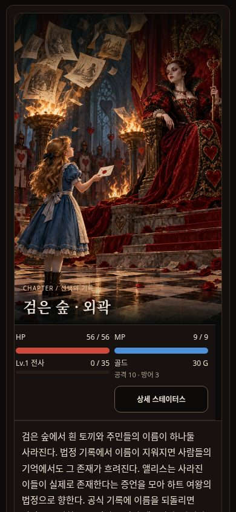
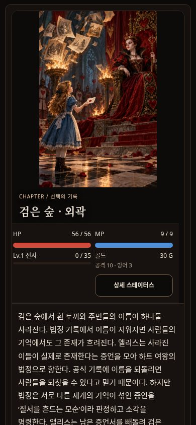
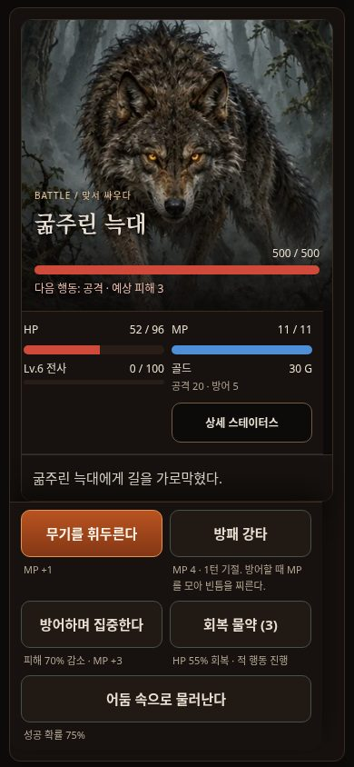
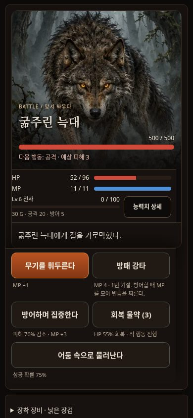

# PR #7 후속 정밀 검수 비교

수정 전 HEAD: `1881f2b1181ece2c8240365983710bbd6f4bc5ed`. 동일 저장·폭·브라우저·다크 설정·카메라에서 촬영했다. 비교 시 카메라는 `#bf-play` 상단 8px 위에 맞추고 모달은 스크롤 0이다. 이미지 편집/합성은 하지 않았다.

## P1 실측

| 폭 | 탐험 이미지·제목 영역 | 첫 선택까지 추가 스크롤 | 전투 플레이어 HUD | 전투 버튼 추가 스크롤 | 보이는 전투 행동 |
|---|---|---|---|---|---|
| 360px | 468.0 → 421.7px | 346.8 → 300.5px | 157.2 → 106.1px | 0.0 → 0.0px | 5 → 5개 |
| 390px | 513.0 → 421.7px | 321.6 → 230.3px | 157.2 → 106.1px | 0.0 → 0.0px | 5 → 5개 |
| 430px | 573.0 → 421.7px | 267.3 → 116.0px | 157.2 → 106.1px | 0.0 → 0.0px | 5 → 5개 |

선택 스크롤은 첫 행동 버튼 전체를 볼 때까지 필요한 추가 거리다. 탐험 원본 그림 자체는 350px 높이의 contain으로 표시하고 제목을 그림 밖에 두어 인물과 장면을 가리지 않는다. 전투는 기존 sticky dock이 있어 수정 전부터 버튼 5개가 보였으며 버튼 수 증가로 보고하지 않는다. HUD 높이는 활성 효과가 없는 동일 전사 fixture의 `.stats`를 측정했다. 효과가 있으면 실존 상태/남은 턴은 추가 줄에 보존한다.

## 360px 전후 캡처

| 화면 | 수정 전 | 수정 후 |
|---|---|---|
| 탐험 | [전](screenshots/before-360-exploration.jpg) | [후](screenshots/after-360-exploration.jpg) |
| 전투 | [전](screenshots/before-360-battle.jpg) | [후](screenshots/after-360-battle.jpg) |
| 직업·전직 | [전](screenshots/before-360-jobs.jpg) | [후](screenshots/after-360-jobs.jpg) |
| 전설 보상 | [전](screenshots/before-360-reward.jpg) | [후](screenshots/after-360-reward.jpg) |
| 장비 | [전](screenshots/before-360-equipment.jpg) | [후](screenshots/after-360-equipment.jpg) |

## 390px 전후 캡처

| 화면 | 수정 전 | 수정 후 |
|---|---|---|
| 탐험 | [전](screenshots/before-390-exploration.jpg) | [후](screenshots/after-390-exploration.jpg) |
| 전투 | [전](screenshots/before-390-battle.jpg) | [후](screenshots/after-390-battle.jpg) |
| 직업·전직 | [전](screenshots/before-390-jobs.jpg) | [후](screenshots/after-390-jobs.jpg) |
| 전설 보상 | [전](screenshots/before-390-reward.jpg) | [후](screenshots/after-390-reward.jpg) |
| 장비 | [전](screenshots/before-390-equipment.jpg) | [후](screenshots/after-390-equipment.jpg) |

## 430px 전후 캡처

| 화면 | 수정 전 | 수정 후 |
|---|---|---|
| 탐험 | [전](screenshots/before-430-exploration.jpg) | [후](screenshots/after-430-exploration.jpg) |
| 전투 | [전](screenshots/before-430-battle.jpg) | [후](screenshots/after-430-battle.jpg) |
| 직업·전직 | [전](screenshots/before-430-jobs.jpg) | [후](screenshots/after-430-jobs.jpg) |
| 전설 보상 | [전](screenshots/before-430-reward.jpg) | [후](screenshots/after-430-reward.jpg) |
| 장비 | [전](screenshots/before-430-equipment.jpg) | [후](screenshots/after-430-equipment.jpg) |

## 390px 대표 화면

## 유지·남은 검토

- NPC/동료 대화, 심부·중심부 이야기, 보스, 이벤트의 이미지와 엔딩은 원래 큰 표시를 유지한다. 지도·상인은 그림 전체 220px, 외곽 접근 이야기는 그림 350px + 분리한 제목을 사용한다.
- 전직 이미지와 조건을 균형 있게 배치하고 완료/미완료 + ✓/○를 병행한다. 잠긴 버튼은 불투명 읽기 가능한 텍스트로 유지하며 실제 입력은 차단한다.
- 장착은 불씨 강조, 보관은 금빛 테두리, 판매는 절제한 테두리로 구분한다. 3개 모두 52px이다.
- 슬롯 카드는 종류/이름/희귀도/핵심 수치를 분리하고 전체 옵션·설명은 기존 상세 영역에 보존한다.
- 긴 이야기의 모든 서술과 선택을 유지하므로 탐험의 스크롤을 완전히 없애지는 않는다. contain 표시의 좌우 여백은 그림 전체 보존을 위한 의도적 선택이다.
- 실제 기기·장시간 플레이·FPS는 NOT TESTED. Firefox의 실제 반응형/터치 QA는 CI에서 실행하며 로컬 실행으로 보고하지 않는다.
